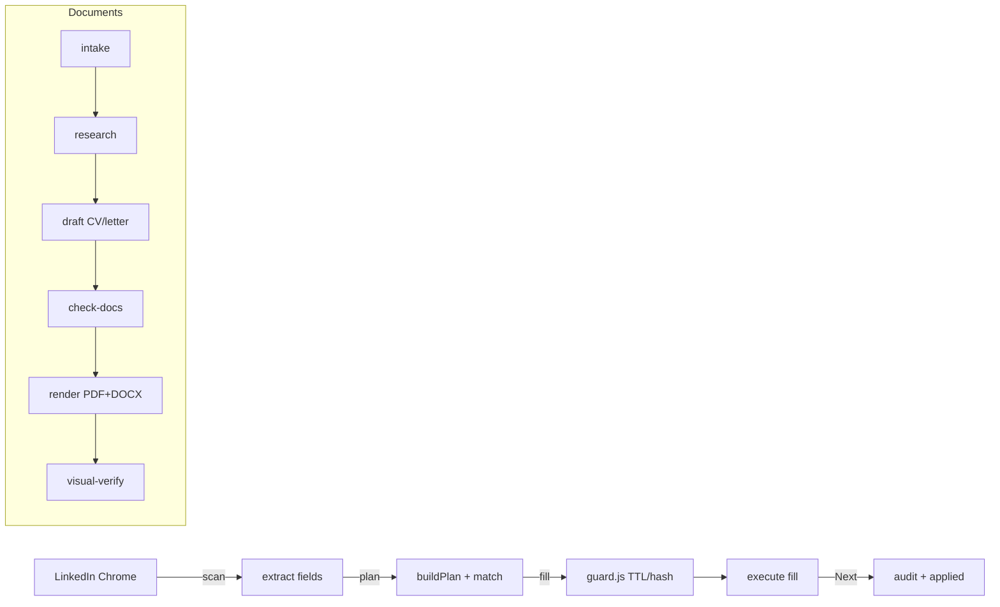

# jobbot

[](https://github.com/shahriarhaqueabir/jobbot/actions/workflows/ci.yml)
[](https://nodejs.org)
[](#testing)
[](#testing)
[](#license)

> **Local-first assistant for preparing and submitting job applications on LinkedIn
> Easy Apply.** Researches the vacancy, tailors a CV and cover letter, enforces a
> hard preparation gate, and drives the browser fill flow — while **never
> uploading a file and never clicking Submit.**

This repository ships **source code, tests, templates and persona definitions
only**. Personal data (CVs, cover letters, application logs, profile/answers,
rendered output, agent memory) is gitignored and must be supplied locally.

---

## Why jobbot

Most "auto-apply" tools click Submit for you. jobbot refuses to. It automates
the _tedious_ part (scanning forms, matching answers, filling fields, drafting
documents) and keeps the _consequential_ part (file uploads, final submission)
in human hands. Every safety invariant is enforced in code, not documentation:

- 🛑 **Terminal-button block** — Submit / Send / Absenden can never be clicked
  by the bot (`src/fill/guard.js`).
- 🧾 **Preparation gate** — an application cannot start until job URL, master
  CV review, tailored documents, user review and hash match are all present
  (`src/preparation/gate.js`).
- 📅 **Daily cap** — configurable applications/day (default 10), enforced from
  the audit log.
- 🔒 **Path confinement** — manifest document paths cannot escape the
  application folder.
- 🧾 **Hash-bound review** — editing a draft invalidates its review
  (`src/workflow/machine.js`).

## Architecture



See [docs/ARCHITECTURE.md](docs/ARCHITECTURE.md) for the full walkthrough.

## Screenshots

| Dashboard (control tower)                             | Rendered CV (A4)                        |
| ----------------------------------------------------- | --------------------------------------- |
|  |  |

> Screenshots are optional and not committed by default. Add your own under
> `docs/screenshots/` to showcase the UI.

## Requirements

- Node.js 26.x (see `.nvmrc`; `engines` in `package.json`)
- Google Chrome (rendering + browser flow)
- Poppler (`pdftoppm`) for PDF visual verification
- Optional: chromedriver (resolved via `JOBBOT_CHROME`, a repo-local
  `bin/chromedriver.exe`, or Selenium Manager)

## Install

```bash
npm ci
```

## Quick start

1. Copy the example profile and answers into place and edit them:

   ```bash
   cp data/examples/profile.example.json data/profile.json
   cp data/examples/answers.example.json data/answers.json
   ```

2. Put your master CV and cover letter in `CVs/MASTER_CV.md` and
   `CVs/MASTER_COVER_LETTER.md` (these are gitignored).

3. Run the test suite:

   ```bash
   npm test
   ```

4. Start the dashboard:

   ```bash
   npm run dashboard
   ```

5. Render a document:

   ```bash
   npm run render -- <input.md> [output-dir] [--lang de|en] [--title "Title"]
   ```

## Commands

| Command           | Description                                                    |
| ----------------- | -------------------------------------------------------------- |
| `jobbot browser`  | Launch Chrome with an ephemeral profile                        |
| `jobbot check`    | Prove the Selenium attach works                                |
| `jobbot open`     | Click Easy Apply and wait for the modal                        |
| `jobbot scan`     | Read-only field dump of the current page                       |
| `jobbot plan`     | Build a fill plan from the last scan (dry run)                 |
| `jobbot apply`    | Execute the pending plan (fills one page, clicks Next only)    |
| `jobbot status`   | Daily cap usage + recent audit entries                         |
| `jobbot intake`   | Create a new application folder from a job URL                 |
| `jobbot workflow` | Show workflow state for an application folder                  |
| `jobbot approve`  | Approve a workflow step: `jobbot approve <folder> <step>`      |
| `jobbot render`   | Render a markdown file to PDF + DOCX                           |
| `jobbot verify`   | Render a PDF to PNG pages for visual inspection                |
| `jobbot scaffold` | Verify/unlock/save/lock/reset/restore/reconcile a managed file |
| `jobbot answers`  | Check an application's answers against the library             |

## Safety

- The assistant never uploads a file and never clicks Submit.
- A configurable daily cap (default 10) is enforced from the audit log.
- A preparation gate (`assertPreparationComplete`) blocks any application until
  job URL, master CV review, documents, user review and hash match are present.
- Personal data is never committed; see `.gitignore`.

## Layout standard

CV and cover-letter templates use locked style tokens (Arial 9.5pt / 10.5pt,
1.4 line height, 15mm / 0.79in margins, black text only, bullet glyph U+25CF,
A4) that can be updated with user approval. Content lives only in plain Markdown
data files.

## Testing

```bash
npm test            # full suite (145 tests)
npm run test:browser # browser smoke test (requires Chrome)
npm run osv         # dependency vulnerability gate
```

See [docs/TEST_PLAN.md](docs/TEST_PLAN.md) for the test strategy.

## Contributing

See [CONTRIBUTING.md](CONTRIBUTING.md).

## Changelog

See [CHANGELOG.md](CHANGELOG.md).

## User guide

See [docs/USER_GUIDE.md](docs/USER_GUIDE.md).

## License

Private project.
