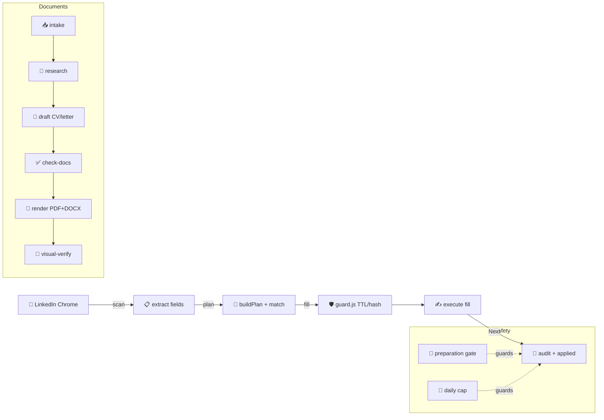

# APLTE - Apply to LinkedIn Together

<p align="center">
  
</p>

> **Local-first assistant for preparing and submitting job applications on LinkedIn
> Easy Apply.** Researches the vacancy, tailors a CV and cover letter, enforces a
> hard preparation gate, and drives the browser fill flow — while **never
> uploading a file and never clicking Submit.** 🛑

[](https://github.com/shahriarhaqueabir/jobbot/actions/workflows/ci.yml)
[](https://nodejs.org)
[](#testing)
[](#testing)
[](#license)

---

## Fun things you can do

- Run a supervised browser flow that researches, tailors, and pre-fills applications while you stay in control
- Generate role-specific CV and cover-letter drafts from one local command
- Keep an audit trail of every gate decision - nothing uploads, nothing submits without you

---

## 🎬 The story — why this exists

Most "auto-apply" tools click Submit for you. That is the one action that
cannot be undone, and automating it is how people get banned, send the wrong CV,
or apply to 200 jobs with a typo. jobbot refuses to do it. It automates the
_tiring_ 90% (scanning forms, matching answers, filling fields, drafting
documents) and keeps the _consequential_ 10% (file uploads, final submission)
in human hands. Every safety rule is enforced in code, not in a README. 🛡️

The goal was never "apply to 1000 jobs." The goal was: **make applying to one
job take 5 minutes instead of 45, without ever losing control of the outcome.**

> 💡 **The one sentence that drove everything:** _Automate the tedious part, keep
> the consequential part human._

---

## 🔁 The feedback loop that built it (zero → finished)

This is the loop. Re-run it in this order when recreating or extending.
Every step closes a failure mode.

```
  1. 🔍 SCAN       read the page, extract fields (no writes)
  2. 🧠 PLAN       match fields to answers, score confidence, list unknowns
  3. 👀 REVIEW     human reads the plan; nothing is filled yet
  4. ✍️  FILL       fill one page, read back values, assert match
  5. ➡️  ADVANCE    click "Next" only — never Submit, never upload
  6. 📓 AUDIT      append to applied.jsonl + audit.jsonl (append-only truth)
  7. 🚧 GATE       block the next application until prep is complete + hash matches
  8. 🎨 RENDER     markdown → PDF + DOCX, locked style tokens
  9. 🔎 VERIFY     PDF → PNG per page, inspect every page by eye
 10. 🔁 REPEAT     only after visual verify passes
```

> 🧠 **Secret of the loop:** every step is reversible until step 5, and step 5
> is reversible until step 6. Nothing becomes "real" until it is audited. The
> audit log _is_ the undo history.

---

## 🏗️ Architecture — how the pieces talk



| Component    | Responsibility                                         | Key file                  |
| ------------ | ------------------------------------------------------ | ------------------------- |
| 🛡️ Guard     | Terminal-button block, plan TTL, safe args             | `src/fill/guard.js`       |
| 🚧 Gate      | Preparation completeness, path confinement, hash match | `src/preparation/gate.js` |
| 📅 Cap       | Daily application cap from audit log                   | `src/fill/cap.js`         |
| 🧠 Workflow  | Hash-bound review, step order, approvals               | `src/workflow/machine.js` |
| 🎨 Render    | Markdown → PDF + DOCX, locked style tokens             | `src/render/*.js`         |
| 🖥️ Dashboard | Control tower, SSE streams, actions                    | `tools/dashboard/*.js`    |

See [docs/ARCHITECTURE.md](docs/ARCHITECTURE.md) for the full walkthrough.

---

## 🏆 Good choices (and why they were good)

1. **🛡️ Safety as code, not docs.** `guard.js` refuses to click Submit.
   `gate.js` blocks applications. These are tested, not described. Docs rot;
   tests don't.
2. **📓 Append-only audit truth.** `applied.jsonl` and `audit.jsonl` are the
   source of truth. Status, cap, and history are derived from them. No second
   database to drift.
3. **🧾 Hash-bound review.** A document is "reviewed" only when its recorded
   hash matches the current file. Edit the draft → review resets. This single
   rule killed an entire class of "I edited it after approving" bugs.
4. **🔒 Path confinement.** Manifest document paths are resolved inside the
   application folder. A traversal attempt returns null and fails the check.
   Cheap, decisive, testable.
5. **🌐 Ephemeral browser profile.** Every `jobbot browser` run gets a fresh
   profile under the OS temp dir. Re-login each time. No stale cookies, no
   cross-session leakage.
6. **🎨 Locked style tokens.** Arial 9.5pt/10.5pt, 1.4 line height, 15mm/0.79in
   margins, black text only, bullet U+25CF, A4. Content lives in plain
   Markdown. Layout never leaks into content.
7. **🔀 Separation of personal vs. public.** Two trees: `jobbot/` (public,
   clean history) and `jobbot-private/` (personal data, not git-tracked). The
   `.gitignore` is the enforcement mechanism, not discipline.
8. **⚡ Split the browser smoke test out of `npm test`.** `npm test` stays fast
   and portable (145 tests, no Chrome required); `npm run test:browser` is
   opt-in.
9. **🔐 OSV + gitleaks in CI.** Supply-chain and secret scanning run on every
   push. Caught a stray `eslint` devDependency with a vulnerable `minimatch`.
10. **🧾 Traceability rule for personas.** Every persona appends to
    `persona-runs.jsonl` and `live.log`. The dashboard's agent monitor and the
    audit trail come for free.

> ✨ **Rule of thumb:** if a decision can be enforced by a test, enforce it by
> a test.

---

## 📋 The playbook — recreate this from zero

Follow these steps in order. Do not skip. Each one closes a failure mode.

### Phase 0 — Scope 🎯 (1 hour)

1. Write the one sentence.
2. List the hard boundaries. These become tests before they become code.

### Phase 1 — Skeleton 🦴 (half day)

3. `npm init`, Node 26, ESM (`"type": "module"`).
4. Create `src/cli.js` with a `switch (command)` dispatcher and `usage()`.
5. Add `.gitignore` _first_, before any data file exists.
6. Add `data/examples/` so the repo is runnable by a stranger.

### Phase 2 — Safety core 🛡️ (1 day)

7. Implement `src/fill/guard.js`: plan TTL, terminal-button block, safe args.
   Tests first (red-green).
8. Implement `src/preparation/gate.js`: resolve, assert present, assert complete,
   validate. Test every failure branch.
9. Implement `src/fill/cap.js`: configurable cap, assert under cap, count on
   date. Read from `data/preferences.json` + `JOBBOT_DAILY_CAP` env.
10. Add `src/workflow/machine.js`: hash-bound review, step order, approvals.

### Phase 3 — Browser layer 🌐 (1 day)

11. `src/browser/driver.js`: Chrome discovery, version matching, preflight.
12. `src/browser/launch.js`: launch args, safe args, DevTools reuse, ephemeral
    profile per run.
13. `src/browser/open.js`, `scan`, `plan`, `execute`: scan → plan → fill one
    page → click Next only. Read back every value.
14. `src/scan/challenge.js`: detect CAPTCHA/challenge before acting.

### Phase 4 — Document pipeline 📄 (2 days)

15. `src/render/style.js`: locked style tokens. `cv.js`, `letter.js`, `pdf.js`,
    `docx.js`, `md.js`, `manifest.js`.
16. `jobbot render`: markdown → PDF + DOCX.
17. `jobbot verify`: PDF → PNG per page (`pdftoppm`). Inspect by eye.
18. Intake + workflow state machine + approve/advance commands.

### Phase 5 — Dashboard 🖥️ (2 days)

19. `tools/dashboard/`: Node HTTP server, SSE streams (data + live log), actions
    endpoint, scaffold lifecycle.
20. `gatherData`, `performAction`, path confinement, CSRF guard.

### Phase 6 — Personas & memory 🧠 (1 day)

21. Persona markdown files with traceability rules.
22. Memory pipeline: global / project / learning stores.

### Phase 7 — Tests & CI 🧪 (1 day)

23. Node built-in test runner. One test file per module. 145+ tests.
24. Split browser smoke test into `npm run test:browser`.
25. GitHub Actions: `npm ci` → `npm test` → `npm run osv`.
26. `.gitleaks.toml` for secret scanning.

### Phase 8 — Ship 🚢 (half day)

27. OSV gate clean. `npm audit` clean.
28. README with badges, Mermaid diagram, quick start, commands, safety,
    testing, contributing, changelog, user guide.
29. Push only the clean branch. Keep personal data in a separate,
    non-git-tracked tree.

---

## ⚠️ Mistakes to avoid (learned the hard way)

- 🚫 **Layout in content.** Spaces for alignment, `---` dividers, HTML in
  Markdown — all cause rendering bugs. CSS in the template only.
- 🚫 **Persisted browser profile.** Stale sessions and cookie leakage.
  Ephemeral per run, re-login each time.
- 🚫 **Trusting mtime on Windows.** Two files written in the same millisecond
  compare equal. Add a path-based tiebreaker.
- 🚫 **`server.close()` without destroying sockets.** Call
  `closeAllConnections()` + destroy tracked sockets first.
- 🚫 **Committing generated/personal artifacts.** Scaffolding versions, CV
  sections, dashboard data. Gitignore them.
- 🚫 **Pushing a branch that ever held personal data.** Blobs live in history.
  Squash onto a clean base.
- 🚫 **Slow tests in the default path.** Keep `npm test` fast and portable.
- 🚫 **Unused devDependencies.** They pull vulnerable transitive deps and
  Dependabot alerts for zero benefit.
- 🚫 **Skipping visual verify.** `pdftoppm` + eye inspection catches overflow,
  clipping, page-count regressions unit tests miss.
- 🚫 **Declaring success without running the verification command.** Show the
  output. Always.

---

## 🧰 Stack

| Layer       | Choice                                    | Why                                     |
| ----------- | ----------------------------------------- | --------------------------------------- |
| 🏃 Runtime  | Node.js 26.x (ESM)                        | Modern, fast, native test runner        |
| 🌐 Browser  | Selenium WebDriver 4.52.0 + Chrome        | Stable attach, no Playwright (excluded) |
| 🎨 Render   | Chrome (PDF) + `docx`                     | Locked tokens, deterministic output     |
| 🔎 Verify   | Poppler (`pdftoppm`)                      | Per-page PNG inspection                 |
| 🧪 Tests    | Node built-in runner                      | Zero deps, fast                         |
| 🔐 Security | OSV gate, gitleaks, `ignore-scripts=true` | Supply-chain + secret scanning          |
| 🚢 CI       | GitHub Actions (ubuntu, Node 26)          | Automated test + audit on every push    |

## 🚀 Quick start

```bash
npm ci
cp data/examples/profile.example.json data/profile.json
cp data/examples/answers.example.json data/answers.json
npm test
npm run dashboard
npm run render -- <input.md> [output-dir] [--lang de|en] [--title "Title"]
```

## 📟 Commands

| Command           | Description                                                    |
| ----------------- | -------------------------------------------------------------- |
| `jobbot browser`  | Launch Chrome with an ephemeral profile                        |
| `jobbot check`    | Prove the Selenium attach works                                |
| `jobbot open`     | Click Easy Apply and wait for the modal                        |
| `jobbot scan`     | Read-only field dump of the current page                       |
| `jobbot plan`     | Build a fill plan from the last scan (dry run)                 |
| `jobbot apply`    | Execute the pending plan (fills one page, clicks Next only)    |
| `jobbot status`   | Daily cap usage + recent audit entries                         |
| `jobbot intake`   | Create a new application folder from a job URL                 |
| `jobbot workflow` | Show workflow state for an application folder                  |
| `jobbot approve`  | Approve a workflow step                                        |
| `jobbot render`   | Render a markdown file to PDF + DOCX                           |
| `jobbot verify`   | Render a PDF to PNG pages for visual inspection                |
| `jobbot scaffold` | Verify/unlock/save/lock/reset/restore/reconcile a managed file |
| `jobbot answers`  | Check an application's answers against the library             |

## 🧪 Testing

```bash
npm test             # 145 tests, no Chrome required
npm run test:browser # browser smoke test (requires Chrome)
npm run osv          # dependency vulnerability gate
```

See [docs/TEST_PLAN.md](docs/TEST_PLAN.md).

## 🤝 Contributing

See [CONTRIBUTING.md](CONTRIBUTING.md). Changes to `src/fill/guard.js` or
`src/preparation/gate.js` require explicit review.

## 📚 Further reading

- [docs/ARCHITECTURE.md](docs/ARCHITECTURE.md) — component map and data flow
- [docs/USER_GUIDE.md](docs/USER_GUIDE.md) — end-user walkthrough
- [docs/CV_COVER_LETTER_GUIDELINES.md](docs/CV_COVER_LETTER_GUIDELINES.md) —
  document writing standard
- [CHANGELOG.md](CHANGELOG.md)

## 📜 License

Private project.
